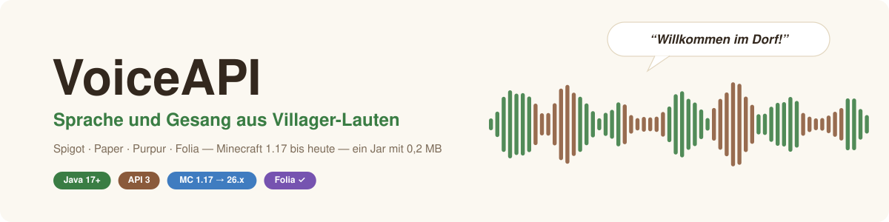
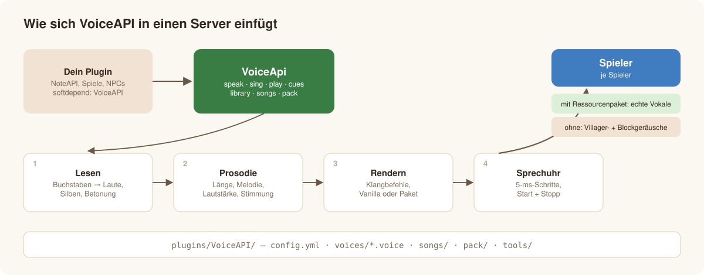

<p align="center"></p>

<p align="center">
  <a href="README.md">English</a> · <b>Deutsch</b> ·
  <a href="docs/de/getting-started.md">Erste Schritte</a> ·
  <a href="docs/de/developer-guide.md">Entwickler-Handbuch</a> ·
  <a href="https://github.com/Passimoritz/MC-VillagerVoice/releases">Download</a>
</p>

**VoiceAPI** (Repository *MC-VillagerVoice*) lässt Minecraft-Villager **sprechen und singen** — auf jedem Bukkit-Server von Minecraft
1.17 bis heute: Spigot, Paper, Purpur und Folia, ein Jar mit 0,2 MB. Ein Text (Deutsch oder Englisch) wird zu Lauten, Silben, Betonung und
Melodie und mit Lauten gespielt, die jeder Spieler schon hat; Spieler mit Ressourcenpaket hören echte Vokale und Konsonanten. Ein
KI-Stimmmodell, nur mit den Villager-Lauten des Spiels trainiert, macht aus echten Liedern Villager-Gesang — auf der CPU, ohne Grafikkarte.

Es ist eine Bibliothek: **keine Befehle**. Die [NoteAPI](https://github.com/Passimoritz/MC-MusicAPI) — oder dein eigenes Plugin — ruft sie auf.

## 🎧 Reinhören

| | Villager-Stimme | |
|---|---|---|
| 🚀 | **J. F. Kennedy** — *„We choose to go to the Moon“* (1962) | [▶ Villager](docs/audio/villager-moon.mp3) · [Original](docs/audio/original-moon.mp3) |
| 🌕 | **Neil Armstrong** — *„That's one small step for man“* (1969) | [▶ Villager](docs/audio/villager-small-step.mp3) · [Original](docs/audio/original-small-step.mp3) |
| 🇩🇪 | **J. F. Kennedy** — *„Ich bin ein Berliner“* (1963) | [▶ Villager](docs/audio/villager-berliner.mp3) · [Original](docs/audio/original-berliner.mp3) |
| 🇩🇪 | **Ernst Reuter** — *„Schaut auf diese Stadt“* (1948, Text per Sprachsynthese vorgelesen) | [▶ Villager](docs/audio/villager-reuter.mp3) |

Gemeinfreie Aufnahmen, 10–20 s, vom Sprechmodus des Plugins umgewandelt (`VoiceApi.convertSpeech`: Rauschen erkannt und gefiltert). Live-Sprache im Spiel (`VoiceApi.speak`):
[Deutsch](docs/audio/speech-de-pack.mp3) · [Englisch](docs/audio/speech-en-pack.mp3) · [ohne Paket](docs/audio/speech-en-vanilla.mp3) ·
[Hexe](docs/audio/speech-en-witch.mp3) · [Singen auf Noten](docs/audio/sing-en-pack.mp3).

## ✨ Was es kann

| | |
|---|---|
| 🗣️ **Sprechen** | Deutsch nach den Regeln der Rechtschreibung, Englisch mit Wörterbuch + Regeln; Zahlen als Wörter; `?` steigt, `.` fällt, `GROSS` und `*Sternchen*` betonen |
| 🎵 **Singen** | Silben auf Noten, Melismen, Legato, Gleiten; das echte Villager-Summen genau auf dem Halbton (mit Paket) |
| 🤖 **KI-Villager-Stimme** | ein RVC-Stimmmodell, nur mit Villager-Lauten trainiert, macht aus echtem Gesang Villager-Gesang — und aus gesprochenen Aufnahmen Villager-Sprache, mit erkanntem und gefiltertem Rauschen. Nur CPU, Linux und Windows |
| 🎭 **9 Stimmen · 10 Stimmungen** | Villager, Händler, Hexe, Hilfsgeist, Piglin, Zombie-Villager, Magier, Ziege, Katze · fröhlich, traurig, wütend, ängstlich, Flüstern, Roboter … |
| ⏱️ **Sprechuhr** | eigener 5-ms-Thread — Laute starten und stoppen auf die Millisekunde, nicht im 50-ms-Server-Tick |
| 📦 **Klein und wartungsfrei** | Jar mit 0,2 MB, Laute einmal geladen (SHA-256 geprüft); gegen die älteste API kompiliert, jede Woche gegen die neueste getestet |



## 🚀 Schnellstart

**Server-Betreiber:** `voiceapi-<Version>.jar` in `plugins/` legen und neu starten. Beim ersten Start werden die Laute (23 MB) im
Hintergrund geladen; mit der NoteAPI landen sie von selbst in deren Ressourcenpaket. → [Erste Schritte](docs/de/getting-started.md)

**Entwickler:**

```java
if (VoiceApi.isAvailable()) {
    Utterance hallo = VoiceApi.speak("Willkommen im Dorf, Reisender!", Language.GERMAN, Speaker.VILLAGER, Style.of(Style.Mood.HAPPY));
    VoiceApi.play(hallo, () -> villager.getLocation(), null, 1.0, null)
            .onWord((index, wort) -> zeigeUntertitel(wort));
}
```

→ [Entwickler-Handbuch](docs/de/developer-guide.md)


## 📚 Doku

| | |
|---|---|
| [Erste Schritte](docs/de/getting-started.md) | installieren, erster Start, Server ohne Internet, aktualisieren |
| [Einstellungen](docs/de/configuration.md) | jede Einstellung in `config.yml` |
| [Entwickler-Handbuch](docs/de/developer-guide.md) | sprechen, singen, abspielen, Stimmen, Stimmungen, Ressourcenpaket, `.voice`-Dateien, API-Übersicht |
| [So funktioniert es](docs/de/how-it-works.md) | Lesen, Prosodie, Rendern, Sprechuhr, Kompatibilität |
| [Lautpaket](docs/de/sound-pack.md) | woher die Laute kommen, Spiegel, eigene Ressourcenpakete |
| [Villager-Gesang](docs/de/villager-singing.md) | das KI-Stimmmodell: Lieder, Einrichtung, Training, Messwerte |
| [Werkzeuge](docs/de/tools.md) | Kommandozeilen-Werkzeug und Python-Werkzeuge |
| [Entwicklung](docs/de/development.md) | bauen, Tests, CI, Releases |
| [Fehlerbehebung](docs/de/troubleshooting.md) | häufige Probleme |
| [Changelog](CHANGELOG.md) | was sich geändert hat (Englisch) |

## 🧩 Kompatibilität


| | |
|---|---|
| Minecraft | **1.17 bis heute (26.x) und künftige Versionen** |
| Server | Spigot, Paper, Purpur, Folia (und Forks) — ein und dasselbe Jar |
| Java | 17 oder neuer |
| Ressourcenpaket | gültig für jedes Paketformat ab 1.17; die Laute (`sounds.json`, OGG) sind seit 1.9 unverändert |

## Icon in Hostwerk

Das Jar enthält `hostwerk-icon.svg` (über `hostwerk-icon:` in `plugin.yml` eingetragen); Hostwerk zeigt es in seiner Plugin-Liste.
