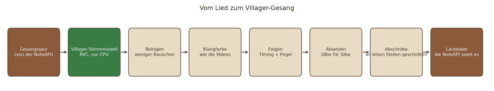
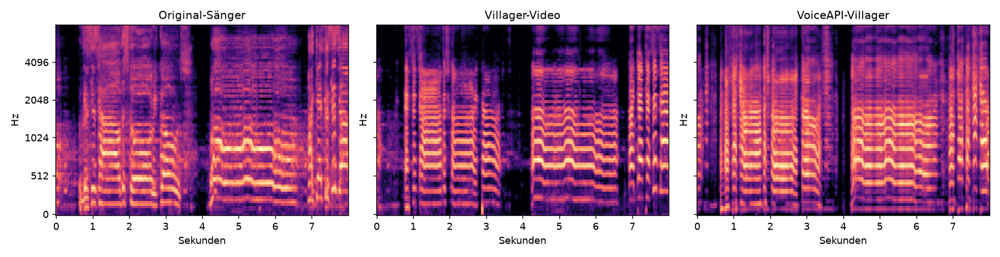
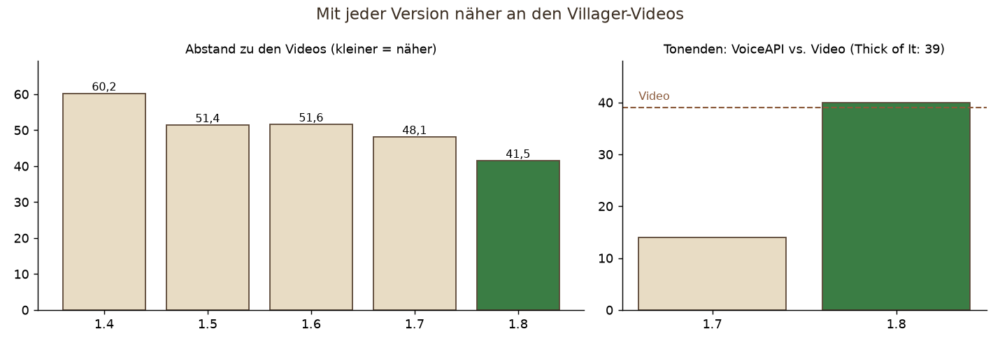
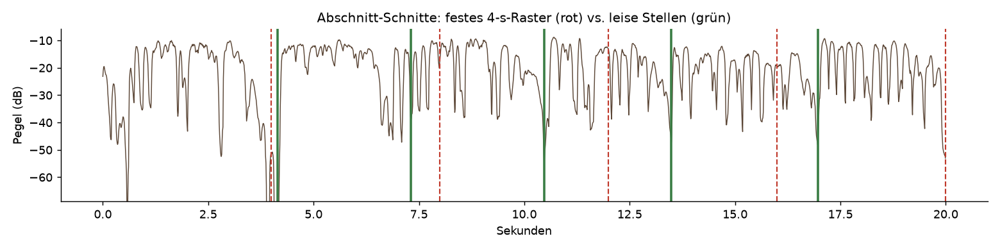

# VoiceAPI

*[English](README.md) · Deutsch*

Sprache und Gesang aus Dorfbewohner-Lauten für **jeden Bukkit-Server ab Minecraft 1.17** – Spigot, Paper, Purpur, Folia, heute und künftig
(Java 17+) – als eigenes Plugin, das andere Plugins (z. B. [NoteAPI](https://github.com/Passimoritz/MC-MusicAPI))
nutzen. Ein Text (Deutsch oder Englisch) wird zu Lauten, Silben, Betonung und Satzmelodie und dann mit den Klängen gesprochen, die jeder Spieler
schon hat: Das „Hmm“ des Dorfbewohners trägt die Vokale, Sand, Kies, ein Knopfklick und ein Lavablubb sind die Konsonanten. Wer das
NoteAPI-Ressourcenpaket mit den VoiceAPI-Lauten geladen hat, hört stattdessen echte Vokale und Konsonanten (Formant-Synthese).

**Keine Befehle.** Die NoteAPI (oder jedes andere Plugin) bindet die VoiceAPI ein und bietet sie an.

- **Sprechen** – `VoiceApi.speak("Willkommen im Dorf!", Language.GERMAN, Speaker.VILLAGER, Style.of(Mood.HAPPY))`: Aussprache nach den Regeln
  der Rechtschreibung (Deutsch) bzw. Wörterbuch + Regeln (Englisch), Zahlen als Wörter, Betonung, Fragen steigen, Punkte fallen, Kommas lassen
  offen, `GROSS` und `*so*` heben hervor, `…` macht eine lange Pause
- **Singen** – `VoiceApi.sing(text, lang, speaker, melodie, style)`: Silben auf Töne (Melismen, Töne je Wort), eine Oktavlage für die ganze
  Melodie, legato. Gesungen wird wie in den bekannten Dorfbewohner-Videos: **nur „Hmm“**, exakt auf den Tönen – dafür braucht es das
  Ressourcenpaket (echtes, sauber geschnittenes und auf den Halbton gezogenes Dorfbewohner-Hmm je Grundton). Mit Vanilla-Klängen trifft der
  Dorfbewohner die Töne nicht (sein Brummen steht nur ~180 ms stabil, das Spiel wählt zufällig eine von drei Aufnahmen), darum gilt
  `sing.require-pack: true`: Spieler ohne Paket hören keinen Gesang, und `VoiceApi.needsPack(utterance)` sagt dem einbindenden Plugin, dass es
  das Paket erzwingen soll
- **9 Stimmen** – Dorfbewohner, Fahrender Händler, Hexe, Allay, Piglin, Zombie-Dorfbewohner, Magier (Wololo), Schreiende Ziege, Katze – jede
  singt mit ihrem eigenen Hmm
- **Smoother Gesang einstellbar** – `SingOptions`: Lautstärke, Dynamik, Binden/Überlappen, Gleiten bei Sprüngen, kürzeste Note
- **10 Stimmungen** – neutral, fröhlich, traurig, wütend, ängstlich, ruhig, aufgeregt, flüstern, Roboter, müde; dazu Tempo, Tonlage, Umfang, Kraft
- **Sprach-Uhr** – eigener Thread mit 5-ms-Schritten: Klänge starten und stoppen auf die Millisekunde (der Server-Tick wäre zu grob)
- **`.voice`-Dateien** – lesbar, von Hand änderbar, Bibliothek in `plugins/VoiceAPI/voices/`
- **Werkzeuge** – `java -jar voiceapi.jar speak …` (ohne Server), `tools/voicelab.py` (so rendern, wie es im Spiel klingt), `tools/build_voice_pack.py`
  (Paket-Laute bauen und in das NoteAPI-Paket mischen), `tools/compare.py` und `tools/sing_test.py` (echter Gesang vs. Dorfbewohner)
- **Villager-Stimmmodell (KI)** – `tools/villager_dataset.py` + `tools/villager_sing.py`: ein eigenes RVC-Stimmmodell, trainiert nur auf
  den Dorfbewohner-Lauten des Spiels, wandelt echten Gesang in die Villager-Stimme – Text, Melodie und Tempo bleiben. Läuft **ohne GPU** (siehe unten)

## Villager-Gesang für echte Lieder



Mit der [NoteAPI](https://github.com/Passimoritz/MC-MusicAPI) bekommt jedes umgewandelte Lied **auf seiner Seite einen Gesangs-Schalter:
Original / Villager / Töne / Aus**. „Villager“ startet `VoiceApi.convertSong` – eine Bossbar zeigt die Schritte („Villager is singing“,
„Writing sections“), bis dahin singt das Original weiter. Ab Minecraft 1.20.3 liefert die NoteAPI den Villager-Gesang als eigenes kleines
Paket je Lied aus; das Grundpaket bleibt gleich. **Die Lautstärke des Villagers** regelst du im Mischpult der NoteAPI (Gesangsspur → Quelle
„Villager“, Regler 0 … 3×, Standard 1 = so laut wie der Original-Sänger, wie in den Videos).



Maßstab sind echte Villager-Cover-Videos. Ein Messplatz vergleicht jede Änderung mit ihnen („Thick of It“, „APT.“: Klangfarbe,
Langzeitspektrum, Stimmhaftigkeit, Tonhöhe, Tonenden):



- **Tonhöhe** sitzt auf den Tönen des Videos (0,10 Halbtöne), Vibrato und Schleifer werden mitgenommen.
- **Silbe für Silbe** (1.8): Die Videos setzen deutlich öfter ab als der Original-Sänger; `--articulation 2` vertieft die Lücken zwischen den
  Silben – Tonenden 14 → 40 (Video 39), Abstand zu den Videos 48,1 → 41,5.
- **Klar statt hauchig** (1.6): kein Rauschen im Modell, Rauschen in gesungenen Stellen gesenkt – Klarheit auf dem Niveau der Videos.
- **Mix** wie in den Videos: Original-Instrumental unverändert, Villager etwa so laut wie der Original-Sänger, Begrenzer statt Abschneiden.
- **Keine doppelten Töne** (1.7): Abschnitte werden an leisen Stellen geschnitten, damit eine schwankende Startverzögerung gestreamter Klänge
  nicht hörbar ist:



**Einstellungen** (`plugins/VoiceAPI/config.yml`, gelten für danach umgewandelte Lieder):

```yaml
rvc:
  home: ""          # ~/.voiceapi/rvc (venv, Applio, Modelle)
  model: villager
  resume: true      # vom Server-Stopp unterbrochene Umwandlungen fortsetzen
  timbre-follow:    # optional, standardmäßig AUS: Klangfarben-Bewegung des Sängers übertragen
    strength: 0.0   # 0 = aus … 1 = voll; 0.3 bewegt sich wie die Videos: lebendiger und verständlicher, etwas weniger „Villager“
    max-db: 6.0     # Grenze je Frequenzband
    window-ms: 400  # was als Bewegung zählt: Änderung gegenüber diesem Mittel
    smooth-ms: 40   # Glättung
```

## Kompatibilität – ohne Pflege

| | |
|---|---|
| Minecraft | **1.17 bis heute (26.x) und künftige Versionen** |
| Server | Spigot, Paper, Purpur, Folia (und Abkömmlinge) – ein und dasselbe Jar |
| Java | 17 oder neuer (Minecraft 1.17–1.20.4 laufen auf 17, neuere auf 21/25 – alle führen das Jar aus) |
| Ressourcenpaket | `pack.mcmeta` gilt für jedes Paketformat ab 1.17 mit offenem oberen Ende; die Laute (`sounds.json`, OGG) sind seit 1.9 gleich |

So bleibt es ohne Wartung gültig:
- **Kleinster gemeinsamer Nenner**: übersetzt gegen die *älteste* unterstützte Spigot-API (1.17.1) mit Java 17 – was hier übersetzt, gibt es auf
  jedem Server. Genutzt wird nur ein kleiner, seit Jahren stabiler Teil der Bukkit-API (Spieler, Orte, Klänge abspielen/stoppen, Scheduler) und
  Gson; kein Server-interner Code (NMS), keine Versionsabfragen, `api-version: '1.17'`.
- **Zur Laufzeit erkannt statt fest verdrahtet**: Folia (eigener Scheduler, per Reflexion), die Klang-Kategorie (nach Namen, mit Ausweichen),
  die Gson-Version (`Compat.json`). Dasselbe Jar läuft überall.
- **Die CI prüft von selbst** – bei jedem Push und **jeden Montag**: übersetzt und testet gegen die älteste *und* die jeweils neueste Paper- und
  Spigot-API (`ci/latest-api.sh` liest sie aus den Maven-Metadaten) und startet echte Server – Paper 1.17.1, 1.20.4, die neueste Paper-Version,
  die neueste Folia und die neueste Spigot (BuildTools) – mit dem Jar (`ci/smoke.py`, Versionen und Java aus der PaperMC-API). Bricht eine neue
  Minecraft- oder Server-Version etwas, schickt GitHub eine Mail – sonst ist nichts zu tun.

## Installation

`voiceapi-<Version>.jar` in den `plugins`-Ordner legen und den Server neu starten. Das Plugin, das sie nutzt, trägt `VoiceAPI` unter `softdepend`
(oder `depend`) ein. Das Jar ist klein (~0,2 MB): Die echten Laute (23 MB) lädt das Plugin beim ersten Start einmal im Hintergrund aus dem
Release [`voice-pack`](https://github.com/Passimoritz/MC-VoiceAPI/releases/tag/voice-pack), prüft sie gegen die eingebaute SHA-256 und legt sie
unter `plugins/VoiceAPI/pack/VoiceAPI-Sounds-base.zip` ab (der Serverstart wartet nie darauf; bis dahin läuft VoiceAPI ohne Ressourcenpaket).
Sobald sie da sind, **mischt die NoteAPI sie von selbst** in ihr Ressourcenpaket (`plugins/VoiceAPI/VoiceAPI-Sounds.zip`). Server ohne Internet:
die Datei aus dem Release laden, nach `plugins/VoiceAPI/pack/VoiceAPI-Sounds-base.zip` legen und neu starten (`pack.download: false` lädt nie;
`pack.download-url` für einen Spiegel) – oder ein Jar mit den Lauten bauen: `mvn package -P bundled-pack`. Mit der NoteAPI singt ein Dorfbewohner die Gesangsmelodie umgewandelter Lieder mit (Frage beim Umwandeln, Mischpult → 🎤 Stimme).
Selbst bauen geht weiter mit `python plugins/VoiceAPI/tools/build_voice_pack.py --merge plugins/NoteAPI/pack/NoteAPI-Sounds.zip`.

## Für Entwickler (Schnittstelle 3)

```java
if (VoiceApi.isAvailable()) {
    Utterance greeting = VoiceApi.speak("Willkommen im Dorf, Reisender!", Language.GERMAN, Speaker.VILLAGER, Style.of(Style.Mood.HAPPY));
    Speech speech = VoiceApi.play(greeting, () -> villager.getLocation(), null, 1.0, () -> log("fertig"));
    speech.onWord((index, word) -> showSubtitle(word));   // für Untertitel
    speech.stop();                                         // abbrechen
}
```

| Was | Wie |
|---|---|
| Text lesen | `VoiceApi.read(text, lang)` → Wörter mit Silben, Betonung, Satzgrenzen |
| sprechen | `VoiceApi.speak(text, lang, speaker, style)` → `Utterance` (ohne Server) |
| singen | `VoiceApi.sing(text, lang, speaker, List<MelodyNote>, style[, SingOptions])` |
| Villager-Gesang (KI) | `VoiceApi.songVoice(id)` → `SongVoice.cues()` / `cuesFrom(ms)`; `convertSong(id, vocalsWav, progress)`, `onSoundPackChanged(…)`, `songVoiceMissing()` |
| abspielen | `VoiceApi.play(utterance, place, listeners, volume, whenDone)` → `Speech`; `say(…)` an einem Ort, `tell(player, …)` nur für einen |
| Klang-Befehle | `VoiceApi.cues(utterance, withPack)` → `Cue` (Klang, Geschwindigkeit, Lautstärke, Start, Stopp) |
| Bibliothek | `VoiceApi.library().save(utterance)` / `get(id)` / `all()` – Dateien `voices/<id>.voice` |
| Paket | `VoiceApi.packAvailable()`, `hearsPack(player)`, `packProbe(predicate)` (statt der NoteAPI-Auskunft), `needsPack(utterance)` (Gesang), `soundPack()` (die beigelegten Laute) |

- **Sprache**: `Language.GERMAN`, `Language.ENGLISH`, `Language.guess(text)`.
- **Stil**: `Style.parse("rate=1.2; pitch=-3; range=1.4; energy=1.1; mood=happy")` oder `Style.of(Mood.SAD).withRate(0.8)`.
- **Stimme**: `Speaker.VILLAGER` … jede hat eine natürliche Tonlage und einen Umfang von ±12 Halbtönen (halbe bis doppelte Geschwindigkeit).
- **Threads**: Aufrufe im Hauptthread. Orte und Zuhörer werden je Server-Tick im Hauptthread abgefragt; Beobachter (`onWord`, `onSegment`) und
  `whenDone` laufen im Hauptthread.
- **Gesang einstellen**: `SingOptions.DEFAULT.withLegato(200, 40).withGlide(2, 50).withDynamics(0.2).withVolume(0.7)` oder
  `SingOptions.parse("legato=200; overlap=40; glide=2; glideMs=50; dynamics=0.2; volume=0.7; minNote=70")`; `SingOptions.DETACHED` = jeder Ton
  angeschlagen (alter Klang).
- **Einstellungen** (`config.yml`): `speech.rate`, `speech.volume`, `speech.category` (Standard: Stimme/Sprache), `sing.require-pack`, `pack.use`,
  `pack.file`, `pack.download`, `pack.download-url`, `rvc.home`, `rvc.model`.

## Wie die Sprache entsteht

1. **Laute** ([`lang`](src/main/java/de/passimoritz/voiceapi/lang)): Deutsch nach den Regeln der Rechtschreibung (Vokallänge aus Dehnungs-h,
   Doppelvokal und Folgekonsonanten; sch, ch als ach-/ich-Laut, st/sp am Anfang, Auslautverhärtung, Murmel-e, vokalisches r, Vorsilben,
   Endungen), Englisch mit einem Wörterbuch der häufigen Wörter und Regeln (stummes e, Digraphe, -tion, -ed, -s …). Silben nach dem
   Prinzip des maximalen Anlauts, Betonung nach Vorsilben und Endungen.
2. **Prosodie** ([`prosody`](src/main/java/de/passimoritz/voiceapi/prosody)): Dauer je Laut (betont länger, unbetont kürzer, Phrasenende
   gedehnt), Melodie (Deklination, Akzent-Gipfel, Satzende fällt/steigt/bleibt offen), Lautstärke, Stimmung; kleine, aus dem Text
   abgeleitete Schwankungen.
3. **Rendern** ([`render`](src/main/java/de/passimoritz/voiceapi/render)): **Vanilla** – das gehaltene „Hmm“ der Stimme wird mit der Tonhöhe
   der Silbe gestartet (um seinen Einsatz vorgezogen) und am Ende des Vokals gestoppt; helle Vokale etwas höher, dunkle tiefer (die Formanten
   wandern mit); offene betonte Vokale beginnen mit dem „Uh!“, Ausrufe mit dem Schrei; Konsonanten aus Block- und Tiergeräuschen, stimmhafte mit
   leisem Stimmton. **Paket** – Sprache: Vokale als Formant-Samples je Grundton (alle 4 Halbtöne, höchstens 2 gestreckt), Konsonanten als
   Samples; Gesang: das echte Dorfbewohner-Hmm (`voiceapi:hum.villager.<grundton>`), nahtlos verlängert und auf den Halbton gezogen.
4. **Abspielen** ([`play`](src/main/java/de/passimoritz/voiceapi/play)): Sprach-Uhr, Stopps, Zuhörer, Paket je Spieler.

Die Zahlen der Stimmen (Einsatz, Länge, Tonlage, Lautheit jedes Klangs) stammen aus einer Vermessung aller Klänge von Minecraft 26.3
(`tools/voicelab.py atlas`).

## Liedtests

`tools/sing_test.py` nimmt ein vom NoteAPI-Umwandler zerlegtes Lied (NCS-Titel), holt den Text mit Whisper Wort für Wort aus der Gesangsspur,
die Melodie aus den erkannten Gesangsnoten, lässt den Dorfbewohner denselben Text auf dieselbe Melodie singen und legt ab: Original,
Dorfbewohner (Vanilla) und Dorfbewohner mit Paket, jeweils allein und mit der Begleitung, plus eine Vergleichsdatei zum Hintereinanderhören und
`report.json` mit Kennzahlen (`tools/compare.py`: Melodie-Kontur und Halbton-Fehler, Rhythmus, Klangfarbe, wie sehr ein Klassifikator Gesang hört).
Maßstab sind drei bekannte „Villager singt“-Videos. Gemessen (Videogesang gegen den Gesang des Originalsongs, beide mit demucs getrennt): Der
Villager singt **in der Lage des Originals** (Mitte 54,0 → 54,1 bzw. 62,6 → 58,7), 0,1–0,2 Halbtöne neben dem Raster, zu 98 % tonal, mit
120–500 Hz um 8–23 dB abgesenkt, Mitten um 700–1400 Hz vorn und über 4 kHz um 9–12 dB gedämpft. Das schaffen weder Hmm-Noten noch ein
klassischer Vocoder (`tools/villager_voice.py`, klingt roboterhaft) – die Videos nutzen ein KI-Stimmmodell, darum der Weg unten.

## Villager-Stimmmodell (KI, nur CPU)

Wie die Videos: ein **RVC-Modell** (Retrieval-based Voice Conversion, Werkzeugkette [Applio](https://github.com/IAHispano/Applio)), das die
Villager-Stimme gelernt hat und jeden Gesang in sie umwandelt. Alles läuft auf der **CPU** – auch auf Linux-Servern ohne Grafikkarte.

1. **Einrichten** (einmal): Python 3.12-Umgebung in `~/.voiceapi/rvc/venv` mit `torch` (CPU-Build) und den Paketen aus Applios
   `requirements-engine.txt` ohne die NVIDIA-Pakete; Applio nach `~/.voiceapi/rvc/Applio`, dann `python core.py prerequisites --no-exe`
   (Basismodelle HiFi-GAN 40k, RMVPE, ContentVec; geladen mit `weights_only=True`).
2. **Daten**: `python tools/villager_dataset.py --out ~/.voiceapi/rvc/dataset/villager` – alle 17 Dorfbewohner-Aufnahmen in 10 Tonlagen
   (−7 … +12 Halbtöne, wie das Spiel sie per Geschwindigkeit spielt) und 3 Tempi: 510 Dateien, 4,2 min.
3. **Trainieren** (in `Applio/`): `core.py preprocess --model-name villager --sample-rate 40000 …`, `core.py extract … --f0-method rmvpe --gpu -`,
   `core.py train --model-name villager --sample-rate 40000 --batch-size 8 --gpu - --total-epoch 200 --save-every-epoch 5`, `core.py index …`.
   Auf einem Ryzen 7 7800X3D dauert eine Runde etwa 4 Minuten (200 Runden ≈ 13 Stunden, einmalig). Danach die Runde nehmen, die den
   Villager-Videos am nächsten kommt – nicht einfach die letzte: Runde 140 schlug 65, 100, 120, 150, 180, 190 und 200. Das fertige Modell
   hängt am Release [`voice-model`](https://github.com/Passimoritz/MC-VoiceAPI/releases/tag/voice-model).
4. **Singen lassen**: `python tools/villager_sing.py --cache <NoteAPI-Cache-Ordner> --out <Ordner> --title "Genre - Titel"` – nimmt die
   getrennte Gesangsspur, wandelt sie mit dem Modell (`~/.voiceapi/rvc/models/villager.pth` oder das neueste Trainingsgewicht) und mischt mit
   der Original-Begleitung. Dateien: `<Titel> - 1 Original - with backing.wav`, `<Titel> - 2 Villager - with backing.wav`,
   `<Titel> - 2 Villager - vocals only.wav`, `<Titel> - Comparison (original first, then Villager).wav`.
   Nach der Umwandlung richtet sich der Gesang nach dem Vortrag des Originals (`follow`): Versatz samplegenau ausgeglichen, Pegel alle 25 ms wie
   das Original (Stille bleibt still), die scharfen Konsonanten des Originals leise dazu (`--consonants 0.5`, `0` = aus; `--no-follow` schaltet
   alles ab). Standard: `--index-rate 1.0` (Villager-Klangfarbe aus dem Index), `--protect 0.5`, `--noise 0` (kein Rauschen im Modell –
   damit klang der Villager hauchig und lustlos), `--clean 0.6` (senkt das Rauschen in gesungenen Stellen; vorher zerfiel bis zu ein Drittel
   davon in Rauschen). Im Mix bleibt das Original-Instrumental
   unverändert und der Villager so laut wie der Original-Sänger – so machen es die Videos (`--vocal-gain` in dB); Begrenzer statt hartem
   Abschneiden. **Gegen die Villager-Videos gemessen** („Thick of It“, „APT.“; kleiner = näher): 60,2 → **51,4**, Tonhöhe wie das Video
   (0,10 Halbtöne). NoteAPI-Likeness an 8 NCS-Liedern: **88,7** (Ziel ≥ 87). Je enger der Gesang dem Original-Vortrag folgt, desto besser
   der NoteAPI-Rhythmus und desto weniger klingt er nach dem Video – die Standards sind der beste Ausgleich. Schnell auf der CPU: ein Lied
   in etwa Echtzeit auf 8 Kernen.

**Im Plugin** (Schnittstelle 3): `VoiceApi.convertSong(id, vocalsWav, progress)` ruft `villager_sing.py --chunks` mit der Umgebung aus `rvc.home`
auf, legt den Gesang als Abschnitte von etwa 4 s – geschnitten an leisen Stellen, damit eine schwankende Startverzögerung gestreamter Klänge nicht
hörbar ist – mit 60 ms Überblendung nach `plugins/VoiceAPI/songs/<id>/` und schreibt das Lautpaket neu (erst in `<id>.part`, am Ende getauscht;
eine durch einen Server-Stopp unterbrochene Umwandlung läuft beim nächsten Start weiter, `rvc.resume`);
`onSoundPackChanged` meldet das dem einbindenden Plugin (die NoteAPI mischt neu und sendet). Abgespielt wird über `VoiceApi.songVoice(id).cues()`
auf der Musik-Uhr des Plugins. Auf einem Server ohne GPU: `python plugins/VoiceAPI/tools/rvc_setup.py --model villager.pth` (Linux und Windows,
auch Windows Server). **Die CI prüft das** jede Woche auf GitHub-Rechnern ohne Grafikkarte (Workflow *Voice model (CPU, Linux + Windows
Server)*, `ci/voice_model_test.py` bricht ab, wenn torch eine GPU sieht).

## Bauen

```
mvn verify                                                          # gegen Spigot-API 1.17.1 (Java 17)
mvn -P paper-latest -Dbukkit.version=$(bash ci/latest-api.sh paper) verify    # Gegenprobe neueste Paper-API
python ci/smoke.py --project paper --version latest --jar target/voiceapi-*.jar   # echter Server
```

Die Python-Werkzeuge in `tools/` werden ins Jar gepackt und beim Start nach `plugins/VoiceAPI/tools/` gelegt; sie brauchen die
NoteAPI-Umgebung (`~/.noteapi/venv`: numpy, scipy, librosa, soundfile) oder ein eigenes Python mit diesen Paketen.

## Symbol in Hostwerk

Die JAR enthält `hostwerk-icon.svg` (in `src/main/resources/`, angemeldet über `hostwerk-icon:` in der `plugin.yml`). Hostwerk zeigt das Symbol in der Plugin-Liste – Anleitung: Hostwerk-README, Abschnitt „Eigenes Plugin-Symbol“.

Code, Kommentare, Logzeilen und Werkzeuge sind englisch; alte deutsche Eingaben (Stimmennamen, Stil- und Gesangsschlüssel wie `stimmung=`, `binden=`) werden weiter verstanden.
