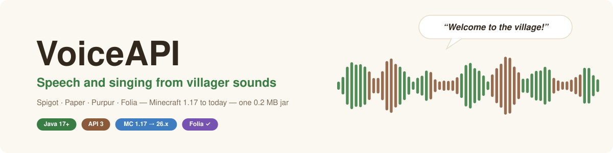
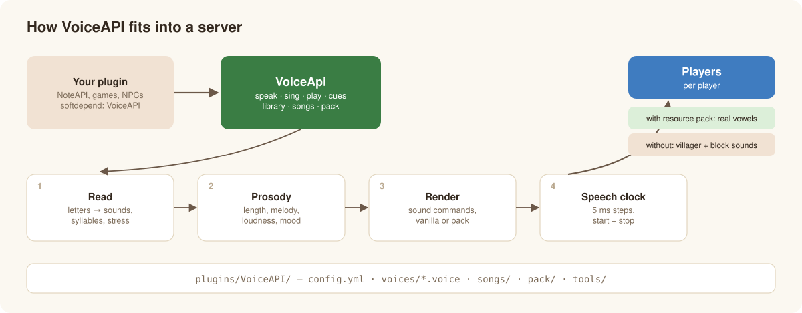

<p align="center"></p>

<p align="center">
  <b>English</b> · <a href="README.de.md">Deutsch</a> ·
  <a href="docs/en/getting-started.md">Getting started</a> ·
  <a href="docs/en/developer-guide.md">Developer guide</a> ·
  <a href="https://github.com/Passimoritz/MC-VillagerVoice/releases">Download</a>
</p>

**VoiceAPI** (repository *MC-VillagerVoice*) lets Minecraft villagers **talk and sing** — on every Bukkit server from Minecraft 1.17 to
today: Spigot, Paper, Purpur and Folia, one 0.2 MB jar. A text (German or English) becomes sounds, syllables, stress and melody and is
played with sounds every player already has; players with the resource pack hear real vowels and consonants. An AI voice model, trained
only on the game's villager sounds, turns real songs into villager singing — on the CPU, no graphics card needed.

It is a library: **no commands**. [NoteAPI](https://github.com/Passimoritz/MC-MusicAPI) — or your own plugin — calls it.

## 🎧 Listen

| | Villager voice | |
|---|---|---|
| 🚀 | **J. F. Kennedy** — *"We choose to go to the Moon"* (1962) | [▶ villager](docs/audio/villager-moon.mp3) · [original](docs/audio/original-moon.mp3) |
| 🌕 | **Neil Armstrong** — *"That's one small step for man"* (1969) | [▶ villager](docs/audio/villager-small-step.mp3) · [original](docs/audio/original-small-step.mp3) |
| 🇩🇪 | **J. F. Kennedy** — *"Ich bin ein Berliner"* (1963) | [▶ villager](docs/audio/villager-berliner.mp3) · [original](docs/audio/original-berliner.mp3) |
| 🇩🇪 | **Ernst Reuter** — *„Schaut auf diese Stadt“* (1948, text read by speech synthesis) | [▶ villager](docs/audio/villager-reuter.mp3) |

Public-domain recordings, 10–20 s, converted by the plugin's speech mode (`VoiceApi.convertSpeech`: noise detected and filtered). Live in-game speech (`VoiceApi.speak`):
[English](docs/audio/speech-en-pack.mp3) · [German](docs/audio/speech-de-pack.mp3) · [without pack](docs/audio/speech-en-vanilla.mp3) ·
[sad](docs/audio/speech-en-sad.mp3) · [singing on notes](docs/audio/sing-en-pack.mp3).

## ✨ What it does

| | |
|---|---|
| 🗣️ **Speak** | German by the rules of spelling, English with dictionary + rules; numbers as words; `?` rises, `.` falls, `CAPS` and `*stars*` emphasise |
| 🎵 **Sing** | syllables on notes, melismas, legato, glides; the real villager hum exactly on the semitone (with the pack) |
| 🤖 **AI villager voice** | an RVC voice model trained only on villager sounds turns real vocals into villager singing — and spoken recordings into villager speech, with noise detected and filtered. CPU only, Linux and Windows |
| 🎭 **The villager · 10 moods** | the voice of the villager videos (the other eight creatures were removed in 1.9.0; their names still work and become the villager) · happy, sad, angry, scared, whisper, robot … |
| ⏱️ **Speech clock** | its own 5 ms thread — sounds start and stop to the millisecond, not on the 50 ms server tick |
| 📦 **Small and maintenance-free** | 0.2 MB jar, sounds downloaded once (SHA-256 checked); compiled against the oldest API, tested weekly against the newest |



## 🚀 Quick start

**Server owners:** put `voiceapi-<version>.jar` into `plugins/` and restart. On the first start the sounds (6 MB) are downloaded in the
background; with NoteAPI they end up in its resource pack by themselves. → [Getting started](docs/en/getting-started.md)

**Developers:**

```java
if (VoiceApi.isAvailable()) {
    Utterance hello = VoiceApi.speak("Welcome to the village, traveler!", Language.ENGLISH, Speaker.VILLAGER, Style.of(Style.Mood.HAPPY));
    VoiceApi.play(hello, () -> villager.getLocation(), null, 1.0, null)
            .onWord((index, word) -> showSubtitle(word));
}
```

→ [Developer guide](docs/en/developer-guide.md)


## 📚 Documentation

| | |
|---|---|
| [Getting started](docs/en/getting-started.md) | install, first start, offline servers, updating |
| [Configuration](docs/en/configuration.md) | every setting in `config.yml` |
| [Developer guide](docs/en/developer-guide.md) | speak, sing, play, voices, moods, resource pack, `.voice` files, API reference |
| [How it works](docs/en/how-it-works.md) | reading, prosody, rendering, speech clock, compatibility |
| [Sound pack](docs/en/sound-pack.md) | where the sounds come from, mirrors, own resource packs |
| [Villager singing](docs/en/villager-singing.md) | the AI voice model: songs, setup, training, measurements |
| [Tools](docs/en/tools.md) | command-line tool and Python tools |
| [Development](docs/en/development.md) | build, tests, CI, releases |
| [Troubleshooting](docs/en/troubleshooting.md) | common problems |
| [Changelog](CHANGELOG.md) | what changed |

## 🧩 Compatibility


| | |
|---|---|
| Minecraft | **1.17 to today (26.x) and future versions** |
| Server | Spigot, Paper, Purpur, Folia (and forks) — one and the same jar |
| Java | 17 or newer |
| Resource pack | valid for every pack format from 1.17 on; the sounds (`sounds.json`, OGG) are unchanged since 1.9 |

## Icon in Hostwerk

The jar contains `hostwerk-icon.svg` (registered via `hostwerk-icon:` in `plugin.yml`); Hostwerk shows it in its plugin list.
