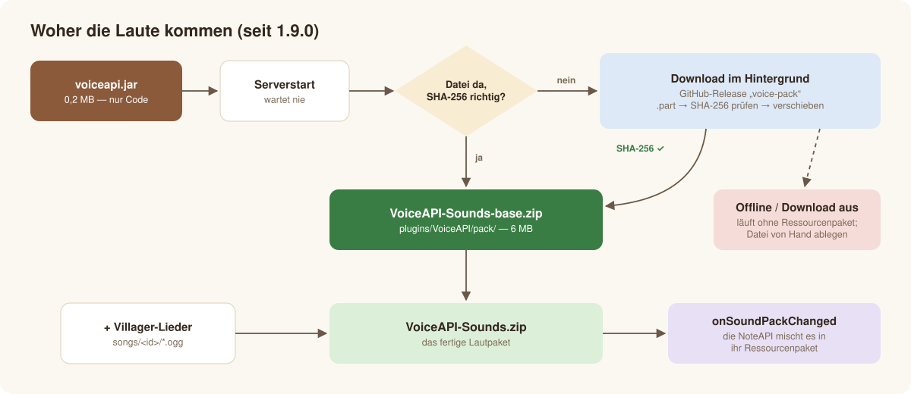

# Erste Schritte

*[English](../en/getting-started.md) · Deutsch* · [← Übersicht](../../README.de.md)

VoiceAPI ist ein **Bibliotheks-Plugin** ohne eigene Befehle. Ein anderes Plugin (zum Beispiel
[NoteAPI](https://github.com/Passimoritz/MC-MusicAPI), ein Minispiel oder ein NPC-Plugin) ruft es auf, um zu sprechen oder zu singen.
Diese Seite bringt es auf einem Server zum Laufen.


## Voraussetzungen

| | |
|---|---|
| Server | Spigot, Paper, Purpur, Folia oder ein Fork — **ein und dasselbe Jar** |
| Minecraft | 1.17 oder neuer (getestet bis 26.3, künftige Versionen prüft die CI jede Woche) |
| Java | 17 oder neuer |
| Internet | einmal, beim ersten Start (23 MB Laute). Danach nicht mehr nötig — siehe [Server ohne Internet](#server-ohne-internet) |

## Installieren

1. `voiceapi-<Version>.jar` aus den [Releases](https://github.com/Passimoritz/MC-VillagerVoice/releases) laden und in `plugins/` legen.
2. Server starten (oder neu starten). Im Log steht:

   ```text
   [VoiceAPI] Enabling VoiceAPI v1.9.0
   [VoiceAPI] Downloading the VoiceAPI sounds in the background from https://github.com/Passimoritz/MC-VillagerVoice/releases/download/voice-pack/VoiceAPI-Sounds-3284456f7161.zip
   [VoiceAPI] VoiceAPI 1.9.0 ready: 9 voices, 0 saved utterances, 0 villager songs, resource pack without VoiceAPI sounds, …
   Done (10.986s)! For help, type "help"
   [VoiceAPI] Downloaded the VoiceAPI sounds (23123 KB) from https://github.com/…
   ```

   Der Serverstart wartet nie auf den Download. Bis die Laute da sind, funktioniert VoiceAPI schon mit Vanilla-Lauten.
3. Das Plugin installieren, das VoiceAPI nutzt (z. B. die NoteAPI). Es trägt `VoiceAPI` in seiner `plugin.yml` unter `softdepend` oder
   `depend` ein.

Das ist alles. Mit der NoteAPI landen die Laute von selbst in deren Ressourcenpaket; Spieler, die das Paket annehmen, hören echte Vokale
und Konsonanten, alle anderen Villager- und Blockgeräusche.



## Was in `plugins/VoiceAPI/` liegt

| Pfad | Was es ist |
|---|---|
| `config.yml` | Einstellungen — siehe [Einstellungen](configuration.md) |
| `pack/VoiceAPI-Sounds-base.zip` | die geladenen Grundlaute (gegen eine im Plugin eingebaute SHA-256 geprüft) |
| `VoiceAPI-Sounds.zip` | das fertige Lautpaket: Grundlaute + umgewandelte Villager-Lieder; die NoteAPI mischt es in ihr Ressourcenpaket |
| `voices/*.voice` | gespeicherte Äußerungen (lesbarer Text, siehe [Entwickler-Handbuch](developer-guide.md#voice-dateien)) |
| `songs/<id>/` | Villager-Gesang umgewandelter Lieder (Abschnitte als OGG + `voice.json`) |
| `tools/` | die Python-Werkzeuge, bei jedem Start aus dem Jar entpackt (immer die Version des Jars) |

## Erst mal reinhören

**Das Villager-Stimmmodell** (KI, dasselbe, das Lieder singt) spricht berühmte Reden — je 10–20 s:

| | |
|---|---|
| 🚀 Kennedy — *„We choose to go to the Moon“* (1962) | [▶ Villager](../audio/villager-moon.mp3) · [Original](../audio/original-moon.mp3) |
| 🌕 Armstrong — *„That's one small step for man“* (1969) | [▶ Villager](../audio/villager-small-step.mp3) · [Original](../audio/original-small-step.mp3) |
| 🇩🇪 Kennedy — *„Ich bin ein Berliner“* (1963) | [▶ Villager](../audio/villager-berliner.mp3) · [Original](../audio/original-berliner.mp3) |
| 🇩🇪 Reuter — *„Schaut auf diese Stadt“* (1948, Text per Sprachsynthese vorgelesen) | [▶ Villager](../audio/villager-reuter.mp3) |

**Live-Sprache im Spiel** — was `VoiceApi.speak` auf dem Server abspielt, so gerendert, wie der Minecraft-Client die Klangbefehle spielt:

| | |
|---|---|
| 🗣️ Deutsch, Villager, mit Paket | [▶ anhören](../audio/speech-de-pack.mp3) |
| 🗣️ Englisch, Villager, mit Paket | [▶ anhören](../audio/speech-en-pack.mp3) |
| 🗣️ Englisch, nur Vanilla-Laute (ohne Paket) | [▶ anhören](../audio/speech-en-vanilla.mp3) |
| 🧙 Hexe, aufgeregt · 😢 Villager, traurig | [▶ Hexe](../audio/speech-en-witch.mp3) · [▶ traurig](../audio/speech-en-sad.mp3) |
| 🎵 Singen auf Noten (Summen) | [▶ anhören](../audio/sing-en-pack.mp3) |

## Server ohne Internet

Ein Server ohne Internet läuft ohne die Laute des Ressourcenpakets, bis die Datei da ist. Drei Wege:

1. **Von Hand:** `VoiceAPI-Sounds-<sha>.zip` aus dem Release
   [`voice-pack`](https://github.com/Passimoritz/MC-VillagerVoice/releases/tag/voice-pack) laden, als
   `plugins/VoiceAPI/pack/VoiceAPI-Sounds-base.zip` speichern und neu starten. `pack.download: false`, damit VoiceAPI es nie versucht.
2. **Spiegel:** die Datei selbst hosten und `pack.download-url` setzen (`{sha}` = erste 12 Zeichen der Prüfsumme, `{sha256}` = alle).
3. **Großes Jar:** ein Jar mit den Lauten bauen: `mvn package -P bundled-pack` (≈ 24 MB, lädt nie etwas).

## Aktualisieren

Jar ersetzen und neu starten. Braucht die neue Version andere Laute, kennt das Plugin deren Prüfsumme und lädt sie einmal; sonst wird
nichts geladen. Gespeicherte Äußerungen und umgewandelte Lieder bleiben.

## Wie geht's weiter

- [Einstellungen](configuration.md) — jede Einstellung erklärt
- [Entwickler-Handbuch](developer-guide.md) — dein Plugin sprechen und singen lassen
- [Villager-Gesang](villager-singing.md) — KI-Villager-Stimme für echte Lieder (nur CPU)
- [Fehlerbehebung](troubleshooting.md)
