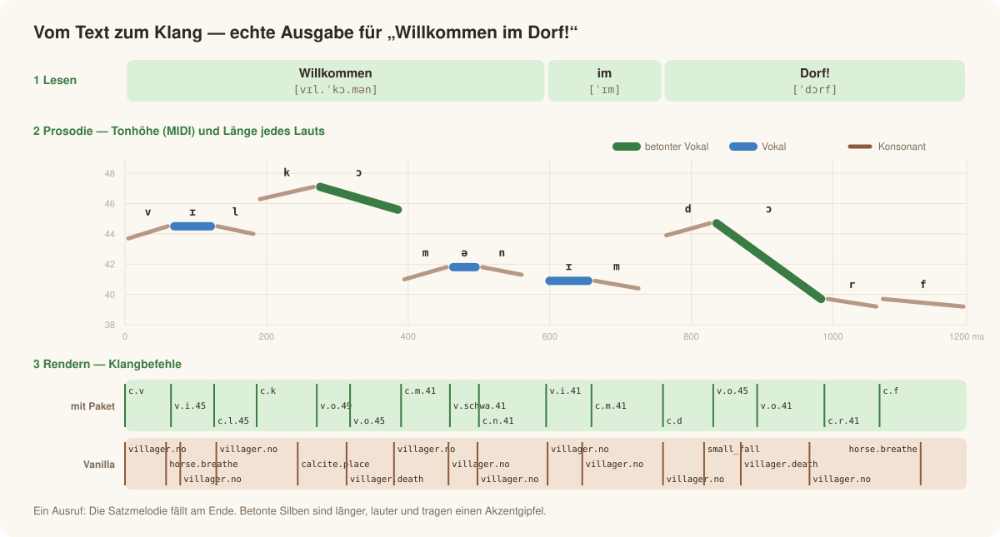
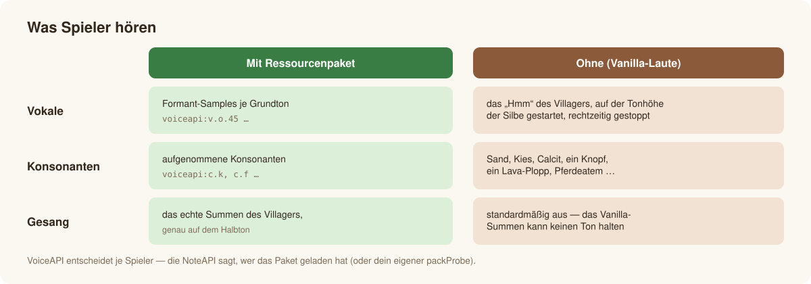
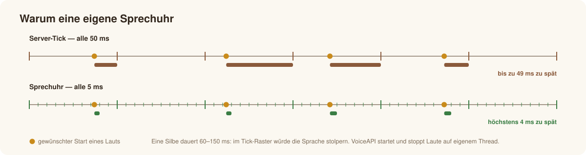
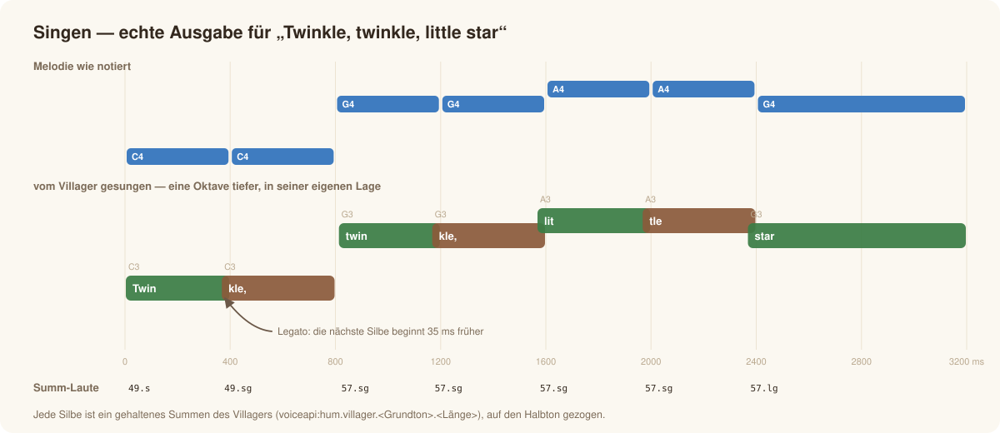
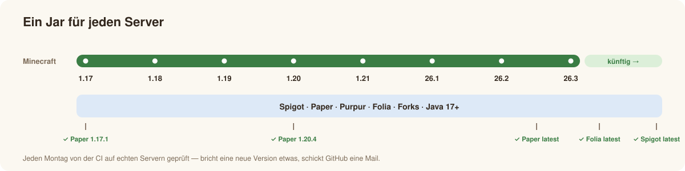

# So funktioniert es

*[English](../en/how-it-works.md) · Deutsch* · [← Übersicht](../../README.de.md)

Minecraft kann vom Server aus keine beliebigen Audiodaten abspielen — nur Sound-Events, mit halber bis doppelter Geschwindigkeit, und sie
stoppen. Genau daraus baut VoiceAPI Sprache: Ein Text wird zu einer zeitlich genauen Liste von Klangbefehlen.

## 1. Lesen — aus Buchstaben werden Laute

Paket [`lang`](../../src/main/java/de/passimoritz/voiceapi/lang).

- **Deutsch** nach den Regeln der Rechtschreibung: Vokallänge aus Dehnungs-*h*, Doppelvokalen und folgenden Konsonanten; *sch*, *ch* als
  „ach“-/„ich“-Laut, *st*/*sp* am Wortanfang, Auslautverhärtung, Schwa, vokalisches *r*, Vorsilben und Endungen.
- **Englisch** mit einem Wörterbuch häufiger Wörter plus Regeln (stummes *e*, Digraphen, *-tion*, *-ed*, *-s* …).
- **Silben** nach dem Prinzip des maximalen Anlauts; **Betonung** aus Vorsilben und Endungen; Zahlen werden als Wörter gesprochen.
- `Language.guess(text)` wählt die Sprache, wenn du es nicht tust.

## 2. Prosodie — wie es gesagt wird

Paket [`prosody`](../../src/main/java/de/passimoritz/voiceapi/prosody).

- **Länge** je Laut: betont länger, unbetont kürzer, Phrasenenden gedehnt.
- **Melodie**: Die Tonhöhe sinkt über einen Satz langsam ab (Deklination), betonte Silben bekommen einen Akzentgipfel, das Ende fällt
  (`.` `!`), steigt (`?`) oder bleibt offen (`,`).
- **Lautstärke und Stimmung**: `Style` (Tempo, Tonlage, Umfang, Kraft) und zehn Stimmungen formen alles; kleine Schwankungen werden aus
  dem Text abgeleitet, derselbe Satz klingt also immer gleich.

## 3. Rendern — aus Lauten werden Klangbefehle

Paket [`render`](../../src/main/java/de/passimoritz/voiceapi/render). Zwei Renderer, **je Spieler** gewählt:

**Vanilla** (ohne Ressourcenpaket): Das gehaltene „Hmm“ der Stimme wird auf der Tonhöhe der Silbe gestartet — um seinen Einsatz früher —
und am Vokalende gestoppt. Helle Vokale liegen etwas höher, dunkle tiefer (die Formanten wandern mit der Geschwindigkeit). Offene betonte
Vokale beginnen mit dem „Uh!“, Ausrufe mit dem Schrei. Konsonanten sind Block- und Tiergeräusche (Sand, Kies, Calcit, ein Knopf, ein
Lava-Plopp, Pferdeatem …); stimmhafte bekommen einen leisen Stimmton.

**Paket**: Vokale sind Formant-Samples je Grundton (alle 4 Halbtöne, höchstens um 2 gestreckt), Konsonanten aufgenommene Samples. Gesang
nutzt das echte Summen des Villagers (`voiceapi:hum.villager.<Grundton>.<Länge>`), nahtlos verlängert und genau auf den Halbton gezogen.

Die Stimmwerte (Einsatz, Länge, Tonhöhe, Lautheit jedes Vanilla-Lauts) stammen aus der Messung aller Laute von Minecraft 26.3
(`tools/voicelab.py atlas`).

## 4. Abspielen — die Sprechuhr

Paket [`play`](../../src/main/java/de/passimoritz/voiceapi/play).

Der Server-Tick (50 ms) ist für Silben von 60–150 ms zu grob. VoiceAPI hat einen eigenen Thread in 5-ms-Schritten, der Laute auf die
Millisekunde startet und stoppt. Orte (wer wo spricht) und Zuhörer werden jeden Tick auf dem Hauptthread aktualisiert; Beobachter
(`onWord`, `onSegment`) und `whenDone` laufen ebenfalls auf dem Hauptthread. Auf Folia wird der Regions-Scheduler genutzt — zur Laufzeit erkannt.

## Singen

`VoiceApi.sing` verteilt die Silben auf die Melodie (Melismen erlaubt), schiebt die ganze Melodie oktavweise in die Lage der Stimme,
bindet Noten (Legato) und gleitet bei großen Sprüngen. Mit Ressourcenpaket ist jede Silbe ein gehaltenes Summen des Villagers, genau auf
der Note. Ohne kann der Villager keinen Ton halten (sein Summen ist nur ~180 ms stabil, das Spiel wählt zufällig einen von drei Takes),
darum hören Gesang standardmäßig nur Spieler mit Paket (`sing.require-pack`).

## Kompatibel ohne Wartung

- **Kleinster gemeinsamer Nenner**: gegen die *älteste* unterstützte Spigot-API (1.17.1) mit Java 17 kompiliert — was dort kompiliert,
  gibt es auf jedem Server. Nur ein kleiner, seit Jahren stabiler Teil der Bukkit-API (Spieler, Orte, Laute abspielen/stoppen, Scheduler)
  plus Gson; kein Server-Innenleben (NMS), keine Versionsabfragen, `api-version: '1.17'`.
- **Zur Laufzeit erkannt**: Folia (eigener Scheduler, per Reflection), die Soundkategorie (nach Namen, mit Ausweichwerten), die Gson-Version.
- **CI** kompiliert und testet gegen die älteste und neueste Paper- und Spigot-API und startet jeden Montag echte Server (Paper 1.17.1,
  1.20.4, neueste, Folia neueste, Spigot neueste). Siehe [Entwicklung](development.md).
