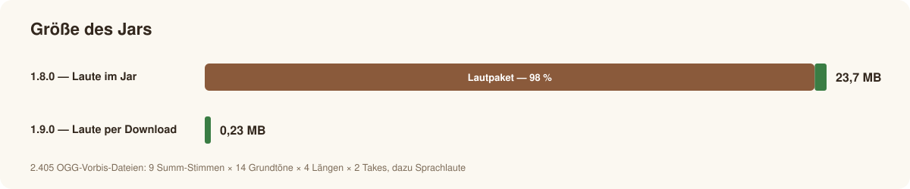

# Lautpaket

*[English](../en/sound-pack.md) · Deutsch* · [← Übersicht](../../README.de.md)

Die echten Vokale, Konsonanten und Summ-Laute sind **2.405 kurze OGG-Vorbis-Dateien** (9 Summ-Stimmen × 14 Grundtöne × 4 Längen × 2 Takes,
dazu Sprachlaute) — 23 MB. Seit 1.9.0 liegen sie **nicht mehr im Jar**:



Neu kodieren hätte nur etwa 23 % gespart (jede kleine OGG trägt einen 3–4 KB großen Vorbis-Header, und Minecraft spielt nur Ogg Vorbis),
deshalb werden die Laute stattdessen geladen — einmal.

## Wie die Laute auf den Server kommen


1. Beim Start prüft VoiceAPI `plugins/VoiceAPI/pack/VoiceAPI-Sounds-base.zip` gegen die **im Plugin eingebaute SHA-256**.
2. Fehlt sie oder weicht ab → lädt es `VoiceAPI-Sounds-<erste 12 Zeichen der SHA>.zip` aus dem Release
   [`voice-pack`](https://github.com/Passimoritz/MC-VillagerVoice/releases/tag/voice-pack) **im Hintergrund**. Der Serverstart wartet nie.
3. Der Download landet in `….zip.part` (höchstens 128 MB), wird geprüft und erst dann verschoben. Ein kaputter oder falscher Download
   ersetzt nie eine gute Datei.
4. VoiceAPI schreibt `plugins/VoiceAPI/VoiceAPI-Sounds.zip` = Grundlaute + umgewandelte Villager-Lieder und ruft jeden
   `VoiceApi.onSoundPackChanged`-Listener auf dem Hauptthread auf. Die NoteAPI mischt die Laute dann in ihr Ressourcenpaket und verschickt es.

Bis die Laute da sind, läuft VoiceAPI „ohne Ressourcenpaket“ — Spieler hören Villager- und Blockgeräusche (Sprache) oder nichts (Gesang,
bei `sing.require-pack: true`).

Weil der Dateiname die Prüfsumme enthält, können mehrere Versionen im selben Release liegen; alte Plugin-Versionen finden ihre Datei weiter.

## Offline, Spiegel, eigene Dateien

| Lage | Was tun |
|---|---|
| Server ohne Internet | Datei aus dem Release laden, als `plugins/VoiceAPI/pack/VoiceAPI-Sounds-base.zip` speichern, neu starten; `pack.download: false` |
| Eigener Spiegel | `pack.download-url: "https://example.org/VoiceAPI-Sounds-{sha}.zip"` (`{sha}` = 12 Zeichen, `{sha256}` = alle) |
| Eigene, geänderte Laute | deine Zip dort ablegen und `pack.download: false` setzen. Jedes VoiceAPI-Paket im aktuellen Format wird auch mit anderer Prüfsumme genutzt |
| Gar keine Downloads | das große Jar bauen: `mvn package -P bundled-pack` — die Laute sind drin, nichts wird geladen |

## Die Laute im eigenen Ressourcenpaket nutzen

Die NoteAPI macht das von selbst. Ein anderes Plugin kann es genauso:

```java
VoiceApi.soundPack().ifPresent(zip -> inMeinPaketMischen(zip));   // assets/voiceapi/** + Einträge in sounds.json
VoiceApi.onSoundPackChanged(this::meinPaketNeuBauen);              // geladen, Lied umgewandelt oder gelöscht
VoiceApi.packProbe(spieler -> meinPaket.hatGeladen(spieler));      // VoiceAPI sagen, wer die Paket-Laute hört
```

`VoiceApi.soundPackFormat()` ist das Namensformat der Laute (`VoicePack.FORMAT`, heute 2); ein Paket wird nur genutzt, wenn seine Marke
`assets/voiceapi/voiceapi.json` dasselbe Format hat.

## Die Laute selbst bauen

Die Laute macht `tools/build_voice_pack.py` aus den Vanilla-Villager-Lauten:

```bash
python plugins/VoiceAPI/tools/build_voice_pack.py --out VoiceAPI-Sounds.zip
python plugins/VoiceAPI/tools/build_voice_pack.py --merge plugins/NoteAPI/pack/NoteAPI-Sounds.zip
```

## Für Betreuer: neue Laute veröffentlichen

Ändert sich `src/main/resources/pack/VoiceAPI-Sounds.zip`, schlägt der Test `SoundDownloadTest` fehl, bis die Prüfsumme angepasst ist:

1. `sha256sum src/main/resources/pack/VoiceAPI-Sounds.zip` → in `SoundDownload.SHA256` eintragen.
2. Die Datei unter ihrem Prüfsummen-Namen hochladen (alte Versionen bleiben):

   ```bash
   cp src/main/resources/pack/VoiceAPI-Sounds.zip VoiceAPI-Sounds-<erste 12>.zip
   gh release upload voice-pack VoiceAPI-Sounds-<erste 12>.zip -R Passimoritz/MC-VillagerVoice
   ```
