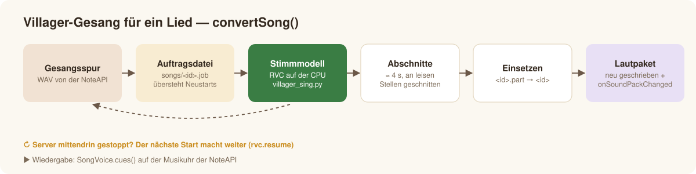

# Villager-Gesang (KI-Stimmmodell)

*[English](../en/villager-singing.md) · Deutsch* · [← Übersicht](../../README.de.md)

Wie die bekannten „Villager singt“-Videos: ein **RVC-Stimmmodell** (Retrieval-based Voice Conversion, Werkzeugkette
[Applio](https://github.com/IAHispano/Applio)), nur mit den Villager-Lauten des Spiels trainiert, macht aus einer echten Stimme die
Villager-Stimme — Worte, Melodie und Timing bleiben. Alles läuft auf der **CPU**, auch auf Linux- und Windows-Servern ohne Grafikkarte.

## Reinhören — berühmte Reden, vom Villager gesprochen

Kurze Ausschnitte (10–20 s) gemeinfreier Aufnahmen, umgewandelt mit dem **Sprechmodus** des Plugins (`VoiceApi.convertSpeech`, unten) —
dasselbe Modell, das die Lieder singt:

| Rede | Villager | Original |
|---|---|---|
| 🚀 J. F. Kennedy — *„We choose to go to the Moon“* (Rice University, 1962) | [▶ Villager](../audio/villager-moon.mp3) | [Original](../audio/original-moon.mp3) |
| 🌕 Neil Armstrong — *„That's one small step for man“* (Apollo 11, 1969) | [▶ Villager](../audio/villager-small-step.mp3) | [Original](../audio/original-small-step.mp3) |
| 🇩🇪 J. F. Kennedy — *„Ich bin ein Berliner“* (Berlin, 1963) | [▶ Villager](../audio/villager-berliner.mp3) | [Original](../audio/original-berliner.mp3) |
| 🇩🇪 Ernst Reuter — *„Schaut auf diese Stadt“* (Berlin, 1948)¹ | [▶ Villager](../audio/villager-reuter.mp3) | — |

¹ Von berühmten deutschen Reden gibt es keine freie Aufnahme; der (gemeinfreie) Text wird per Sprachsynthese vorgelesen und dann
umgewandelt. Erzeugt mit [`tools/doc_speeches.py`](../../tools/doc_speeches.py). Lieder fehlen hier, weil ihre Aufnahmen urheberrechtlich
geschützt sind.

## Sprechmodus: Rauschen erkannt und gefiltert

Gesprochene Aufnahmen sind keine Lieder: Alte Reden tragen Funkrauschen, Hall und Publikum, und das Stimmmodell würde all das zu
„Villager“ machen. `VoiceApi.convertSpeech` (und `tools/villager_speak.py`) darum:

1. **erkennt das Rauschen** — die leisesten 15 % der Aufnahme liefern ein Rauschprofil je Frequenz; der Abstand zwischen Sprache und
   Rauschen entscheidet, ob überhaupt gefiltert wird (eine saubere Aufnahme, z. B. Sprachsynthese, bleibt unangetastet),
2. **filtert es** per spektralem Gating gegen dieses Profil und behält das Sprachband (90–7000 Hz); ist Demucs installiert, wird die Stimme
   vorher vom Hintergrund getrennt,
3. wandelt mit **Sprech-Einstellungen** um (Tonhöhenerkennung rmvpe, die Sprechmelodie bleibt — keine Gesangslage, keine Silbensenken),
4. **schließt die Pausen**: Was das Modell noch aus Rauschen machte und mehr als 24 dB unter der Sprache liegt, wird um 30 dB abgesenkt.

Gemessen an den Ausschnitten oben (Pausen gegen Sprache): Armstrongs Funkaufnahme −70 dB, Kennedy in Berlin −74 dB, die Mond-Rede −46 dB —
vorher machte das Modell aus dem Rauschen ein stetes Villager-Murmeln bei −24 bis −29 dB.

```bash
python plugins/VoiceAPI/tools/villager_speak.py --input rede.wav --out villager.wav [--denoise 0…1] [--gate dB] [--separate auto|on|off]
```

## Lieder mit der NoteAPI


Mit der [NoteAPI](https://github.com/Passimoritz/MC-MusicAPI) bekommt jedes umgewandelte Lied einen **Gesangsschalter: Original /
Villager / Noten / Aus**. „Villager“ startet `VoiceApi.convertSong` — eine Bossbar zeigt die Schritte, bis dahin singt der Originalgesang
weiter. Ab Minecraft 1.20.3 schickt die NoteAPI den Villager-Gesang als kleines eigenes Paket je Lied; das Grundpaket bleibt gleich. Die
Lautstärke des Villagers stellt man im Mischpult der NoteAPI ein (Gesang → „Villager“, 0 … 3×, Standard 1 = so laut wie der Originalsänger).



- Der Gesang wird als Abschnitte von etwa 4 s mit 60 ms Überblendung in `plugins/VoiceAPI/songs/<id>/` gespeichert, **an leisen Stellen
  geschnitten**, damit ein schwankender Startverzug gestreamter Laute nicht zu hören ist.
- Eine Umwandlung schreibt in `<id>.part` und tauscht erst ein, wenn sie fertig ist; eine Auftragsdatei `songs/<id>.job` merkt sich die
  Gesangsspur, und der nächste Start setzt unterbrochene Umwandlungen fort (`rvc.resume`).
- Abgespielt wird über `VoiceApi.songVoice(id).cues()` auf der Musikuhr des einbindenden Plugins (`cuesFrom(ms)` nach einem Sprung).


## Wie nah es kommt

Maßstab sind echte Villager-Cover-Videos („Thick of It“, „APT.“). Ein Prüfstand misst jede Änderung (Klangfarbe, Langzeitspektrum,
Stimmhaftigkeit, Tonhöhe, Tonenden):


- **Tonhöhe** sitzt auf den Noten des Videos (0,10 Halbtöne); Vibrato und Schleifer werden übernommen.
- **Silbe für Silbe** (1.8): Tonenden 14 → 40 (Video: 39), Abstand zu den Videos 48,1 → 41,5.
- **Klar statt hauchig** (1.6): kein latentes Modellrauschen, Zischen in gesungenen Stellen gesenkt.
- **Mischung** wie die Videos: Instrumental unangetastet, Villager etwa so laut wie der Originalsänger, Limiter statt Übersteuern.

## Einrichten (einmal)

```bash
python plugins/VoiceAPI/tools/rvc_setup.py --model villager.pth     # Linux, Windows, Windows Server – nur CPU
python plugins/VoiceAPI/tools/rvc_setup.py --check
```

Das legt eine Python-3.12-Umgebung in `~/.voiceapi/rvc/venv` mit `torch` (CPU-Build) und Applios Engine-Paketen ohne die NVIDIA-Pakete an,
Applio auf einem festen Commit und die Basismodelle (HiFi-GAN 40k, RMVPE, ContentVec; mit `weights_only=True` geladen). Das fertige Modell
hängt am Release [`voice-model`](https://github.com/Passimoritz/MC-VillagerVoice/releases/tag/voice-model) (`villager.pth` +
`villager.index`). `VoiceApi.songVoiceMissing()` listet, was noch fehlt.

## Einstellungen

Siehe [Einstellungen → rvc](configuration.md#rvc--ki-villager-gesang-für-lieder): `rvc.home`, `rvc.model`, `rvc.resume` und die
optionale Klangfarben-Übernahme `rvc.timbre-follow.*` (standardmäßig aus; 0,3 bewegt sich wie die Videos — lebendiger, etwas weniger „Villager“).

## Eigenes Modell trainieren

1. **Daten**: `python tools/villager_dataset.py --out ~/.voiceapi/rvc/dataset/villager [--rich]` — alle 17 Villager-Takes auf 10 Tonhöhen
   und 3 Tempi (510 Dateien, 4,2 min); `--rich` baut Phrasen aus 2–5 Takes mit Vibrato und Schleifern für eine lebendigere Klangfarbe.
2. **Trainieren** in `~/.voiceapi/rvc/Applio`: `core.py preprocess`, `extract … --f0-method rmvpe --gpu -`, `train --sample-rate 40000
   --batch-size 8 --gpu - --total-epoch 200 --save-every-epoch 5`, `index`. Auf einem Ryzen 7 7800X3D dauert eine Epoche etwa 4 Minuten.
3. **Auswählen**: die Epoche, die den Villager-Videos am nächsten kommt (nicht einfach die letzte), nach
   `~/.voiceapi/rvc/models/villager.pth` (+ `.index`) kopieren.

## Kommandozeile

```bash
python tools/villager_sing.py --vocals gesang.wav --backing begleitung.wav --out out/ --title "Künstler - Titel"
python tools/villager_sing.py --cache <NoteAPI-Cache-Ordner> --out out/ --title "Genre - Titel"
```

Wichtige Optionen: `--index-rate 1.0` (Villager-Klangfarbe aus dem Index), `--protect 0.5`, `--noise 0`, `--clean 0.6`,
`--consonants 0.5`, `--articulation`, `--vocal-gain` (dB), `--timbre-follow 0…1`. Umwandlungen laufen über `tools/rvc_infer.py` mit festem
Zufall: Dieselbe Eingabe gibt auf jedem Rechner dasselbe Ergebnis. Auf einer 8-Kern-CPU wandelt sich ein Lied etwa in Echtzeit um.

**Die CI beweist es**: Der Workflow *Voice model (CPU, Linux + Windows Server)* richtet die Umgebung jede Woche auf GitHubs Runnern (ohne
Grafikkarte) neu ein, lädt das Modell und wandelt eine Melodie genau wie das Plugin um.
