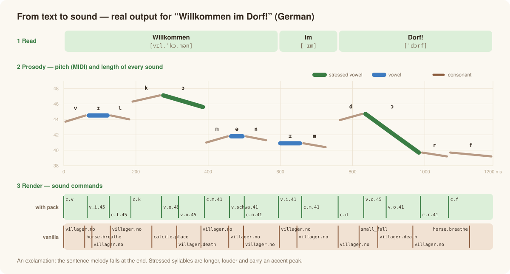
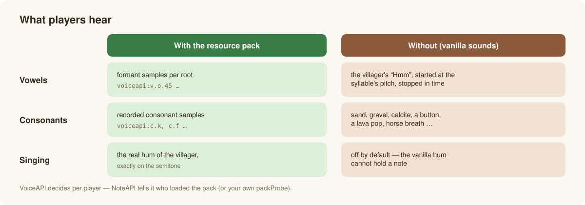
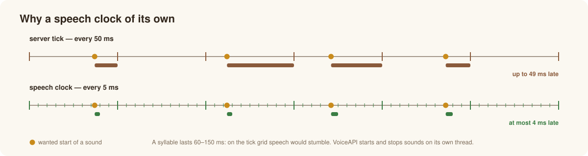
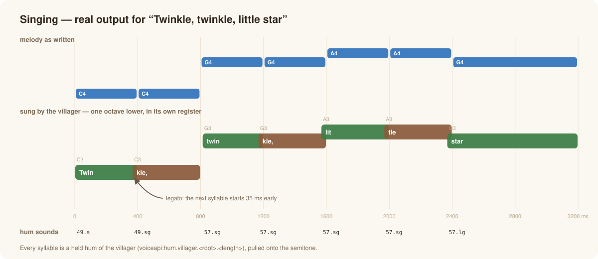
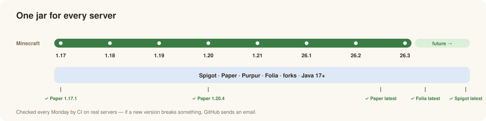

# How it works

*English · [Deutsch](../de/how-it-works.md)* · [← Overview](../../README.md)

Minecraft cannot play arbitrary audio from a server — it can only play sound events, at a speed between half and double, and stop them.
VoiceAPI builds speech out of exactly that: a text becomes a timed list of sound commands.

## 1. Read — letters become sounds

Package [`lang`](../../src/main/java/de/passimoritz/voiceapi/lang).

- **German** by the rules of spelling: vowel length from the lengthening *h*, double vowels and following consonants; *sch*, *ch* as the
  "ach"/"ich" sound, *st*/*sp* at the start of a word, final devoicing, schwa, vocalic *r*, prefixes and endings.
- **English** with a dictionary of frequent words plus rules (silent *e*, digraphs, *-tion*, *-ed*, *-s* …).
- **Syllables** by the maximal onset principle; **stress** from prefixes and endings; numbers are spoken as words.
- `Language.guess(text)` picks the language when you don't.

## 2. Prosody — how it is said

Package [`prosody`](../../src/main/java/de/passimoritz/voiceapi/prosody).

- **Length** per sound: stressed longer, unstressed shorter, phrase ends stretched.
- **Melody**: the pitch slowly falls over a sentence (declination), stressed syllables get an accent peak, the end falls (`.` `!`),
  rises (`?`) or stays open (`,`).
- **Loudness and mood**: `Style` (rate, pitch, range, energy) and ten moods shape all of it; small variations are derived from the text,
  so the same sentence always sounds the same.

## 3. Render — sounds become sound commands

Package [`render`](../../src/main/java/de/passimoritz/voiceapi/render). Two renderers, chosen **per player**:

**Vanilla** (no resource pack): the voice's held "Hmm" is started at the pitch of the syllable — a little earlier, by its onset — and
stopped at the end of the vowel. Bright vowels sit slightly higher, dark ones lower (the formants move with the speed). Open stressed vowels
start with the "Uh!", exclamations with the scream. Consonants are block and animal noises (sand, gravel, calcite, a button, a lava pop,
horse breath …); voiced ones get a quiet voicing tone.

**Pack**: vowels are formant samples per root (every 4 semitones, stretched by at most 2), consonants are recorded samples. Singing uses the
real hum of each voice (`voiceapi:hum.<voice>.<root>.<length>`), extended seamlessly and pulled exactly onto the semitone.

The voice numbers (onset, length, pitch, loudness of every vanilla sound) come from measuring all sounds of Minecraft 26.3
(`tools/voicelab.py atlas`).

## 4. Play — the speech clock

Package [`play`](../../src/main/java/de/passimoritz/voiceapi/play).

The server tick (50 ms) is too coarse for syllables of 60–150 ms. VoiceAPI runs its own thread in 5 ms steps that starts and stops
sounds to the millisecond. Places (who is speaking where) and listeners are refreshed every tick on the main thread; observers
(`onWord`, `onSegment`) and `whenDone` are called on the main thread too. On Folia the region scheduler is used — detected at runtime.

## Singing

`VoiceApi.sing` spreads the syllables over the melody (melismas allowed), moves the whole melody by octaves into the voice's register,
ties notes together (legato) and glides on large jumps. With the resource pack every syllable is a held hum of the voice, exactly on the
note. Without it the villager cannot hold a note (its hum is only steady for ~180 ms and the game picks one of three takes at random), so
singing is only played to players with the pack by default (`sing.require-pack`).

## Compatibility without maintenance

- **Lowest common denominator**: compiled against the *oldest* supported Spigot API (1.17.1) with Java 17 — what compiles there exists on
  every server. Only a small, long-stable part of the Bukkit API is used (players, locations, playing/stopping sounds, scheduler) plus
  Gson; no server internals (NMS), no version checks, `api-version: '1.17'`.
- **Detected at runtime**: Folia (its own scheduler, via reflection), the sound category (by name, with fallbacks), the Gson version.
- **CI** compiles and tests against the oldest and the newest Paper and Spigot API and starts real servers (Paper 1.17.1, 1.20.4, latest,
  Folia latest, Spigot latest) every Monday. See [Development](development.md).
