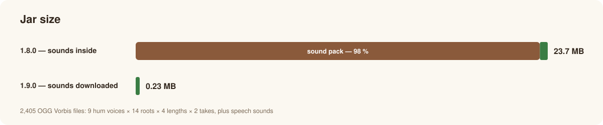
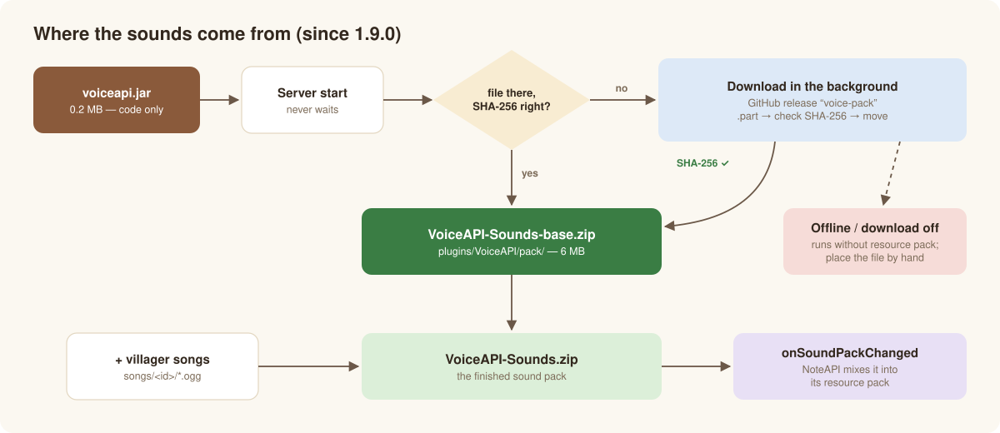

# Sound pack

*English · [Deutsch](../de/sound-pack.md)* · [← Overview](../../README.md)

The real vowels, consonants and hums are **2,405 short OGG Vorbis files** (9 hum voices × 14 roots × 4 lengths × 2 takes, plus speech
sounds) — 23 MB. Since 1.9.0 they are **not inside the jar** any more:



Re-encoding would only have saved about 23 % (every small OGG carries a 3–4 KB Vorbis header, and Minecraft only plays Ogg Vorbis), so
the sounds are downloaded instead — once.

## How the sounds get onto the server



1. On start VoiceAPI checks `plugins/VoiceAPI/pack/VoiceAPI-Sounds-base.zip` against the **SHA-256 built into the plugin**.
2. Missing or different → it downloads `VoiceAPI-Sounds-<first 12 characters of the SHA>.zip` from the release
   [`voice-pack`](https://github.com/Passimoritz/MC-VillagerVoice/releases/tag/voice-pack) **in the background**. The server start never
   waits.
3. The download goes into `….zip.part` (at most 128 MB), is checked, and only then moved in place. A broken or wrong download never
   replaces a good file.
4. VoiceAPI writes `plugins/VoiceAPI/VoiceAPI-Sounds.zip` = base sounds + converted villager songs, and calls every
   `VoiceApi.onSoundPackChanged` listener on the main thread. NoteAPI then mixes the sounds into its resource pack and sends it.

Until the sounds are there, VoiceAPI works "without resource pack" — players hear villager and block sounds (speech) or nothing (singing,
with `sing.require-pack: true`).

Because the asset name contains the checksum, several versions can live in the same release; old plugin versions keep finding their file.

## Offline, mirrors, own files

| Situation | What to do |
|---|---|
| Server without internet | download the file from the release, save it as `plugins/VoiceAPI/pack/VoiceAPI-Sounds-base.zip`, restart; `pack.download: false` |
| Own mirror | `pack.download-url: "https://example.org/VoiceAPI-Sounds-{sha}.zip"` (`{sha}` = 12 characters, `{sha256}` = all) |
| Own, modified sounds | place your zip there and set `pack.download: false`. Any VoiceAPI pack of the current format is used even with another checksum |
| No downloads at all | build the big jar: `mvn package -P bundled-pack` — the sounds are inside and nothing is downloaded |

## Using the sounds in your own resource pack

NoteAPI does this by itself. Another plugin can do the same:

```java
VoiceApi.soundPack().ifPresent(zip -> mergeIntoMyPack(zip));   // assets/voiceapi/** + sounds.json entries
VoiceApi.onSoundPackChanged(this::rebuildMyPack);              // downloaded, song converted or deleted
VoiceApi.packProbe(player -> myPack.hasLoaded(player));        // tell VoiceAPI who hears the pack sounds
```

`VoiceApi.soundPackFormat()` is the naming format of the sounds (`VoicePack.FORMAT`, today 2); a pack is only used when its marker
`assets/voiceapi/voiceapi.json` has the same format.

## Building the sounds yourself

The sounds are made by `tools/build_voice_pack.py` from the vanilla villager sounds:

```bash
python plugins/VoiceAPI/tools/build_voice_pack.py --out VoiceAPI-Sounds.zip
python plugins/VoiceAPI/tools/build_voice_pack.py --merge plugins/NoteAPI/pack/NoteAPI-Sounds.zip
```

## For maintainers: publishing new sounds

When `src/main/resources/pack/VoiceAPI-Sounds.zip` changes, the test `SoundDownloadTest` fails until the checksum is updated:

1. `sha256sum src/main/resources/pack/VoiceAPI-Sounds.zip` → put it into `SoundDownload.SHA256`.
2. Upload the file under its checksum name (old versions stay):

   ```bash
   cp src/main/resources/pack/VoiceAPI-Sounds.zip VoiceAPI-Sounds-<first 12>.zip
   gh release upload voice-pack VoiceAPI-Sounds-<first 12>.zip -R Passimoritz/MC-VillagerVoice
   ```
