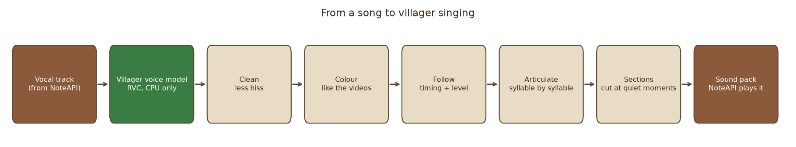
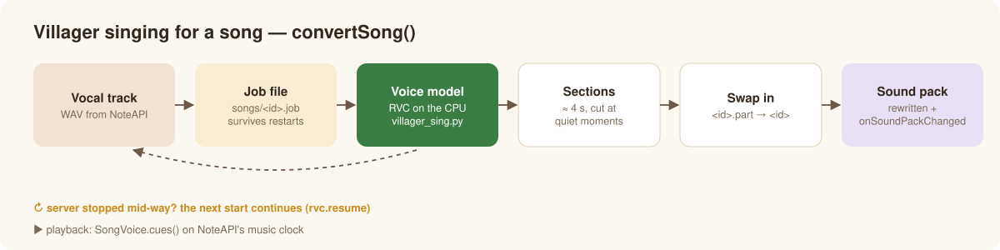
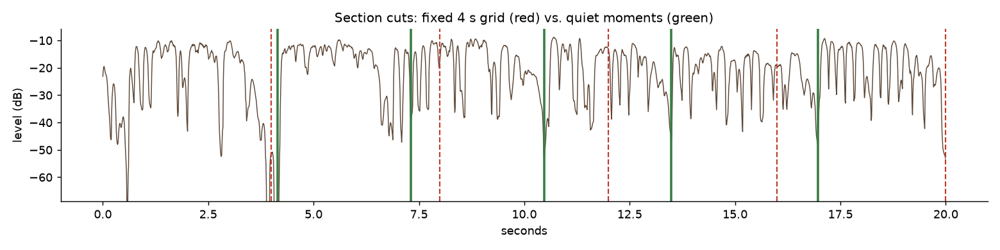
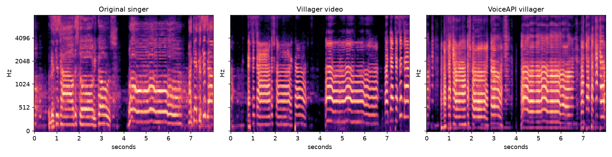
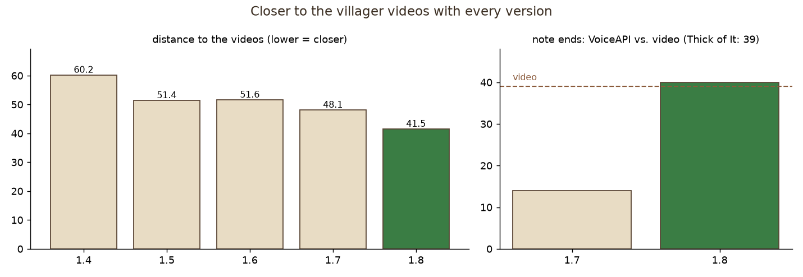

# Villager singing (AI voice model)

*English · [Deutsch](../de/villager-singing.md)* · [← Overview](../../README.md)

Like the well-known "villager sings" videos: an **RVC voice model** (retrieval-based voice conversion, toolchain
[Applio](https://github.com/IAHispano/Applio)), trained only on the game's villager sounds, turns a real voice into the villager voice —
words, melody and timing stay. Everything runs on the **CPU**, also on Linux and Windows servers without a graphics card.

## Listen — famous speeches, spoken by the villager

Short clips (10–20 s) of public-domain recordings, converted with the same model the plugin uses for songs:

| Speech | Villager | Original |
|---|---|---|
| 🚀 J. F. Kennedy — *"We choose to go to the Moon"* (Rice University, 1962) | [▶ villager](../audio/villager-moon.mp3) | [original](../audio/original-moon.mp3) |
| 🌕 Neil Armstrong — *"That's one small step for man"* (Apollo 11, 1969) | [▶ villager](../audio/villager-small-step.mp3) | [original](../audio/original-small-step.mp3) |
| 🇩🇪 J. F. Kennedy — *"Ich bin ein Berliner"* (Berlin, 1963) | [▶ villager](../audio/villager-berliner.mp3) | [original](../audio/original-berliner.mp3) |
| 🇩🇪 Ernst Reuter — *„Schaut auf diese Stadt“* (Berlin, 1948)¹ | [▶ villager](../audio/villager-reuter.mp3) | — |

¹ There is no free recording of a famous German speech; the text (public domain) is read by speech synthesis and then converted.
Made with [`tools/doc_speeches.py`](../../tools/doc_speeches.py). Songs are not included here because their recordings are copyrighted.

## Songs with NoteAPI



With [NoteAPI](https://github.com/Passimoritz/MC-MusicAPI) every converted song gets a **vocals switch: Original / Villager / Notes /
Off**. "Villager" starts `VoiceApi.convertSong` — a boss bar shows the steps, until then the original vocals keep singing. From
Minecraft 1.20.3 NoteAPI sends the villager singing as a small pack of its own per song; the base pack stays the same. The villager's
volume is set in NoteAPI's mixer (vocals → "Villager", 0 … 3×, default 1 = as loud as the original singer).



- The singing is stored as sections of about 4 s with 60 ms crossfades in `plugins/VoiceAPI/songs/<id>/`, **cut at quiet moments** so a
  varying start delay of streamed sounds cannot be heard.
- A conversion writes into `<id>.part` and swaps it in only when complete; a job file `songs/<id>.job` remembers the vocal track, and the
  next start continues interrupted conversions (`rvc.resume`).
- Playback goes through `VoiceApi.songVoice(id).cues()` on the integrating plugin's music clock (`cuesFrom(ms)` after a jump).



## How close it gets

The yardstick are real villager cover videos ("Thick of It", "APT."). A test bench measures every change (timbre, long-term spectrum,
voicing, pitch, note ends):





- **Pitch** sits on the video's notes (0.10 semitones); vibrato and slides are carried over.
- **Syllable by syllable** (1.8): note ends 14 → 40 (video: 39), distance to the videos 48.1 → 41.5.
- **Clear, not breathy** (1.6): no latent model noise, hiss lowered in sung parts.
- **Mix** like the videos: instrumental untouched, villager about as loud as the original singer, a limiter instead of clipping.

## Set up (once)

```bash
python plugins/VoiceAPI/tools/rvc_setup.py --model villager.pth     # Linux, Windows, Windows Server – CPU only
python plugins/VoiceAPI/tools/rvc_setup.py --check
```

This creates a Python 3.12 environment in `~/.voiceapi/rvc/venv` with `torch` (CPU build) and Applio's engine packages without the NVIDIA
ones, Applio at a fixed commit, and the base models (HiFi-GAN 40k, RMVPE, ContentVec; loaded with `weights_only=True`). The finished model
is attached to the release [`voice-model`](https://github.com/Passimoritz/MC-VillagerVoice/releases/tag/voice-model)
(`villager.pth` + `villager.index`). `VoiceApi.songVoiceMissing()` lists what is still missing.

## Settings

See [Configuration → rvc](configuration.md#rvc--ai-villager-singing-for-songs): `rvc.home`, `rvc.model`, `rvc.resume` and the optional
timbre transfer `rvc.timbre-follow.*` (off by default; 0.3 moves like the videos — livelier, a little less "villager").

## Train your own model

1. **Data**: `python tools/villager_dataset.py --out ~/.voiceapi/rvc/dataset/villager [--rich]` — all 17 villager takes at 10 pitches and
   3 tempi (510 files, 4.2 min); `--rich` builds phrases from 2–5 takes with vibrato and glides for a livelier timbre.
2. **Train** in `~/.voiceapi/rvc/Applio`: `core.py preprocess`, `extract … --f0-method rmvpe --gpu -`, `train --sample-rate 40000
   --batch-size 8 --gpu - --total-epoch 200 --save-every-epoch 5`, `index`. On a Ryzen 7 7800X3D one epoch takes about 4 minutes.
3. **Pick** the epoch closest to the villager videos (not simply the last one) and copy it to `~/.voiceapi/rvc/models/villager.pth`
   (+ `.index`).

## Command line

```bash
python tools/villager_sing.py --vocals vocals.wav --backing backing.wav --out out/ --title "Artist - Title"
python tools/villager_sing.py --cache <NoteAPI cache folder> --out out/ --title "Genre - Title"
```

Important options: `--index-rate 1.0` (villager timbre from the index), `--protect 0.5`, `--noise 0`, `--clean 0.6`,
`--consonants 0.5`, `--articulation`, `--vocal-gain` (dB), `--timbre-follow 0…1`. Conversions run through `tools/rvc_infer.py` with
fixed randomness: the same input gives the same result on every machine. On an 8-core CPU a song converts in about real time.

**CI proves it**: the workflow *Voice model (CPU, Linux + Windows Server)* sets the environment up from scratch on GitHub's runners (no
graphics card) every week, downloads the model and converts a melody exactly like the plugin.
